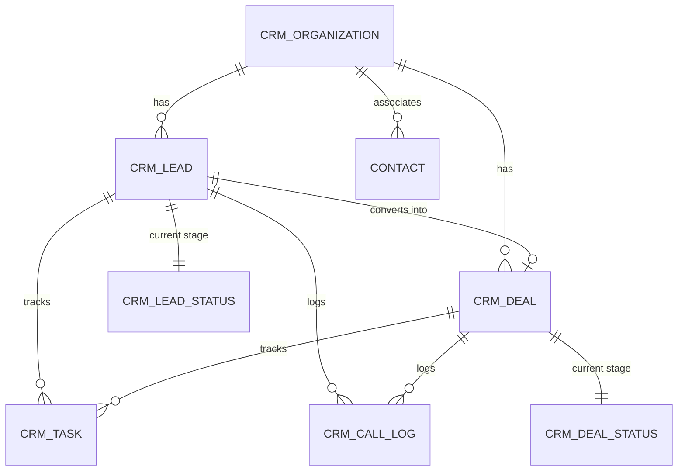

# PC CRM — Database Specification & Dashboard Design Guide

> **Purpose:** Handover document for AI or BI/Dashboard Engineers to design KPI widgets, analytics charts, aggregation pipelines, and SQL queries for the PC CRM platform.

---

## 1. Exported Database Files Available in Project

| File Path | Size | Description | Recommended Usage |
|---|---|---|---|
| [`backup/crm_database.sql`](./backup/crm_database.sql) | ~9.1 MB | **Full Database Dump** (All 286 tables + dummy records) | For local import into MariaDB / MySQL test environment |
| [`backup/crm_schema_only.sql`](./backup/crm_schema_only.sql) | ~310 KB | **Full DDL Schema Only** (All `CREATE TABLE` definitions, no data) | **Best for AI context windows** to design queries & schema models |
| [`backup/crm_core_crm_tables.sql`](./backup/crm_core_crm_tables.sql) | ~74 KB | **Core CRM Tables & Sample Data** (Leads, Deals, Calls, Tasks, Contacts) | Ideal for testing queries on actual dummy rows |

---

## 2. Core Entities & Relational Mapping



### Table Relationships & Key Foreign References
In this Frappe/MariaDB schema, primary keys are strings stored in `name` (e.g. `LEAD-2026-0001` or `DEAL-2026-0005`).

1. **`tabCRM Lead` (`name` is PK)**
   - `organization`: Links to `tabCRM Organization.name`
   - `lead_owner`: Links to `tabUser.name` (Sales Rep)
   - `status`: Links to `tabCRM Lead Status.name`
   - `source`: Links to `tabCRM Lead Source.name`
   - `territory`: Links to `tabCRM Territory.name`

2. **`tabCRM Deal` (`name` is PK)**
   - `lead`: Links back to `tabCRM Lead.name`
   - `organization`: Links to `tabCRM Organization.name`
   - `contact`: Links to `tabContact.name`
   - `deal_owner`: Links to `tabUser.name`
   - `status`: Links to `tabCRM Deal Status.name` (e.g. Qualified, Proposal, Won, Lost)
   - `deal_value` / `expected_deal_value`: Monetary values (DECIMAL)
   - `probability`: Win probability percentage (DECIMAL 0–100)
   - `expected_closure_date`: Target close date (DATE)
   - `closed_date`: Actual win/loss completion date (DATE)

3. **`tabCRM Task` (`name` is PK)**
   - `reference_doctype`: `'CRM Lead'` or `'CRM Deal'`
   - `reference_docname`: Specific Lead or Deal `name`
   - `assigned_to`: Links to `tabUser.name`
   - `status`: Task status (`Open`, `Completed`, `Cancelled`, `Overdue`)
   - `due_date`: Task deadline timestamp
   - `custom_is_sla_task` & `custom_sla_hours`: SLA indicators

4. **`tabCRM Call Log` (`name` is PK)**
   - `reference_doctype` & `reference_docname`: Associated Lead or Deal
   - `caller` / `receiver`: Phone numbers / User identifiers
   - `duration`: Call duration in seconds
   - `status`: Call outcome (`Completed`, `Missed`, `Busy`, `Failed`)
   - `start_time` / `end_time`: Call timestamps

---

## 3. Recommended Dashboard KPIs & Metrics

### A. Executive & Pipeline Overview
* **Total Pipeline Value**: `SUM(deal_value)` WHERE `status NOT IN ('Won', 'Lost')`
* **Weighted Pipeline Forecast**: `SUM(deal_value * (probability / 100))` for open deals
* **Win Rate %**: `COUNT(Won Deals) / (COUNT(Won Deals) + COUNT(Lost Deals)) * 100`
* **Average Deal Cycle Time**: `AVG(DATEDIFF(closed_date, creation))` for Won deals
* **Deals by Stage Funnel**: Count and value grouped by `status` ordered by stage position

### B. Lead Generation & Acquisition
* **New Leads Trend**: Count of `tabCRM Lead` grouped by `DATE_FORMAT(creation, '%Y-%m')`
* **Lead Source Breakdown**: `COUNT(*)` grouped by `source` (Website, Referral, Cold Call, LinkedIn)
* **Lead-to-Deal Conversion Rate**: `(Deals created from Leads / Total Leads) * 100`
* **Lead Distribution by Industry / Territory**: Grouped by `industry` or `territory`

### C. Sales Rep Performance & Productivity
* **Revenue Won by Rep**: `SUM(deal_value)` grouped by `deal_owner` for Won deals
* **Activity Leaderboard**: Total calls (`tabCRM Call Log`) + completed tasks (`tabCRM Task`) per rep
* **Call Duration & Engagement**: `SUM(duration)/60` total talk time in minutes per rep
* **Task SLA Compliance Rate**: `% of tasks completed before due_date`

---

## 4. Sample SQL Queries for Dashboard Backend

### 1. Sales Funnel by Stage & Value
```sql
SELECT 
    d.status AS stage_name,
    s.position AS stage_order,
    COUNT(d.name) AS total_deals,
    COALESCE(SUM(d.deal_value), 0) AS total_stage_value,
    COALESCE(SUM(d.deal_value * (d.probability / 100)), 0) AS weighted_value
FROM `tabCRM Deal` d
LEFT JOIN `tabCRM Deal Status` s ON d.status = s.name
WHERE d.docstatus < 2
GROUP BY d.status, s.position
ORDER BY s.position ASC;
```

### 2. Monthly Revenue Won vs Target
```sql
SELECT 
    DATE_FORMAT(closed_date, '%Y-%m') AS month,
    COUNT(name) AS deals_won_count,
    SUM(deal_value) AS total_revenue_won
FROM `tabCRM Deal`
WHERE status = 'Won' AND closed_date IS NOT NULL
GROUP BY DATE_FORMAT(closed_date, '%Y-%m')
ORDER BY month DESC;
```

### 3. Sales Rep Activity & Conversion Scorecard
```sql
SELECT 
    u.full_name AS rep_name,
    u.name AS rep_email,
    COUNT(DISTINCT l.name) AS total_leads_assigned,
    COUNT(DISTINCT CASE WHEN d.status = 'Won' THEN d.name END) AS deals_won,
    COALESCE(SUM(CASE WHEN d.status = 'Won' THEN d.deal_value ELSE 0 END), 0) AS total_won_revenue,
    COUNT(DISTINCT c.name) AS total_calls_logged,
    ROUND(COALESCE(SUM(c.duration) / 60, 0), 1) AS total_call_minutes
FROM `tabUser` u
LEFT JOIN `tabCRM Lead` l ON l.lead_owner = u.name
LEFT JOIN `tabCRM Deal` d ON d.deal_owner = u.name
LEFT JOIN `tabCRM Call Log` c ON c.owner = u.name
WHERE u.enabled = 1 AND u.user_type = 'System User'
GROUP BY u.name, u.full_name
ORDER BY total_won_revenue DESC;
```

---

## 5. Ready-to-Send AI Prompt

Copy and paste this message directly into your conversation with the other AI:

```text
Here is our CRM database documentation and schema. We are building an analytics and executive dashboard.

Attachments provided:
1. `crm_schema_only.sql`: DDL for all tables and data types.
2. `crm_core_crm_tables.sql`: Core tables with sample records.
3. `CRM_DASHBOARD_DATA_SPEC.md`: Relationship map and business requirements.

Please design:
1. Executive KPI Summary Cards (metrics, calculations, and SQL).
2. Recommended Visual Charts (Funnel, Monthly Trends, Source Breakdown, SLA Heatmap).
3. Optimized SQL views or API queries to feed each dashboard widget.
4. Filter specifications (Date range, Territory, Rep, Pipeline Stage).
```
